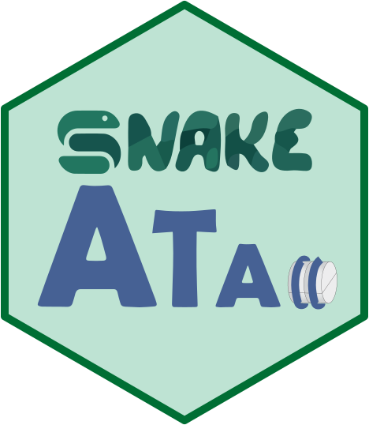

# snakeATAC 

 

#### [v0.1.3](https://github.com/sebastian-gregoricchio/snakeATAC/releases/tag/0.1.3) - November 22th 2026
* **Filtered BAMs keep complete read pairs only** (mapping and analyses workflows). The MAPQ filter and the removal of chrM/other chromosomes act on single reads, so a read whose mate was removed stayed in the BAM as an orphan that still carried the old proper-pair flag, mate position and TLEN: R1 and R2 counts differed in the `*_mapq*_sorted_woMT_*dup.bam` files and MACS3 (`-f BAMPE`) counted orphan R1 reads as complete fragments. After the chromosome filter, mates are now re-paired (`samtools collate` + `samtools fixmate -m`) and only primary, properly paired alignments are kept (`samtools view -f 2 -F 2828`) before duplicate marking. Secondary and supplementary alignments (e.g. `bwa mem -M` split hits) are removed as well. Output file names are unchanged; the step is streamed and leaves no intermediate files.
* Analyses workflow: `gatk FixMateInformation` removed from the BAM filtering (it leaves orphan reads unchanged). The mate CIGAR (MC) tags required by `MarkDuplicatesWithMateCigar` are now added by `samtools fixmate -m`.
* Analyses workflow, UMI-aware duplicate marking: the output BAM is now named `*_mapq*_sorted_woMT_*dup.bam` as expected by all downstream rules (it was `*_mapq*_*dup_sorted.bam`, which stopped UMI runs with a missing-input error).
* **Peak-based normalization** (default ON, with at least 2 samples): DESeq2-like median-of-ratios size factors computed on the consensus peaks (`03_Normalization/peakBased_normalized/peakBased_size_factors.tsv`) and the corresponding normalized bigWigs (RPM / size factor). Group averages are written in `03_Normalization/peakBased_normalized_merged/` when groups are defined. New config section `peak_calling > peak_based_normalization` (`perform_peak_based_normalization`, `bigWig_binSize`).
* **CNA correction fixed**: copy numbers are rounded to integers (round(ploidy x 2log2)), gains and losses beyond `CNA_threshold` are both corrected (CN = 0 is not corrected), the signal is divided by CN/ploidy and `CNA_threshold` is no longer truncated to an integer. New config parameter `copy_number_variation > ploidy` (default 2).
* Consensus peaks are built only from the declared `*_peaks.narrowPeak` files (the previous glob also included the `*_peaks_chr.narrowPeak` copies, duplicating every peak for genomes without the "chr" prefix).
* `ignore_for_normalization` is split on any whitespace.
* The "chr" prefix check before BINDetect no longer fails on genomes without "chr" chromosome names.

 

#### [v0.1.2](https://github.com/sebastian-gregoricchio/snakeATAC/releases/tag/0.1.2) - July 5th 2026
* Optimization of the differential TF footprint rules
* Fixing bugs in the plotting of the footprint profiles

 

#### [v0.1.1](https://github.com/sebastian-gregoricchio/snakeATAC/releases/tag/0.1.1) - November 3rd 2023
* A major updated will follow: this release is to stabilize the current version which will be deprecated later.

 

#### [v0.1.0](https://github.com/sebastian-gregoricchio/snakeATAC/releases/tag/0.1.0) - March 15th 2023
* First release
